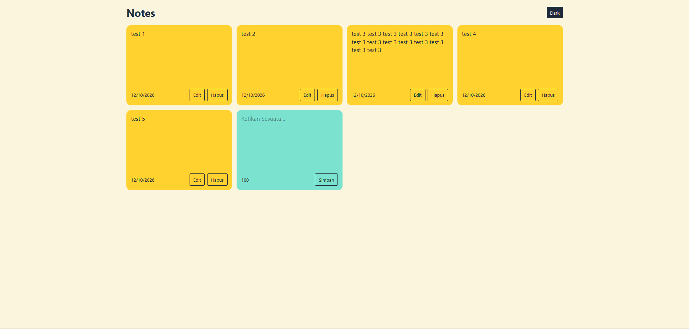
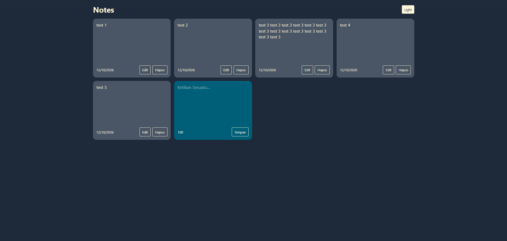

# Notes App

Website notes sederhana menggunakan React + Vite dan juga style menggunakan Tailwind CSS.

# Fitur

1. Create, Read, Update, dan Delete pada note.
2. Tema gelap dan terang
3. Penyimpanan secara localStorage baik untuk note dan tema.

# Tech Stack
1. React
2. Vite
3. Tailwind CSS
4. localStorage

# Install

1. Install dependencies: `pnpm install`
2. Install tailwind: `pnpm install tailwindcss @tailwindcss/vite`
3. run: `pnpm run dev`

# Screenshots

